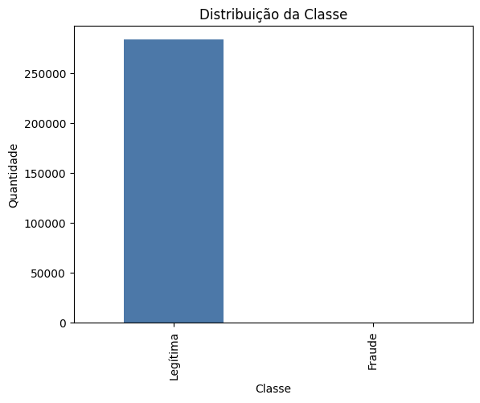
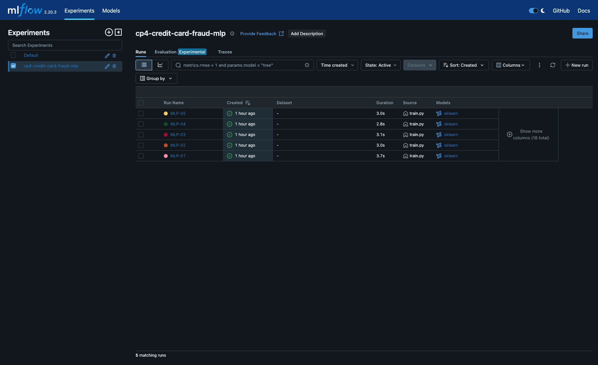
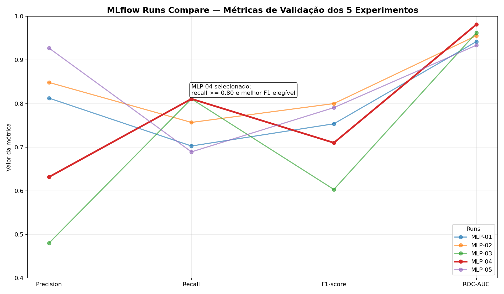
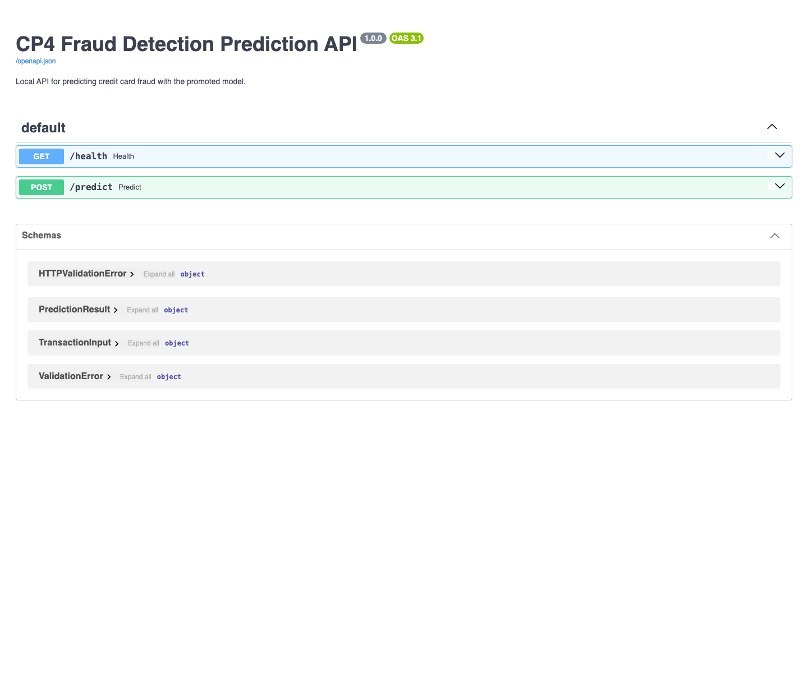
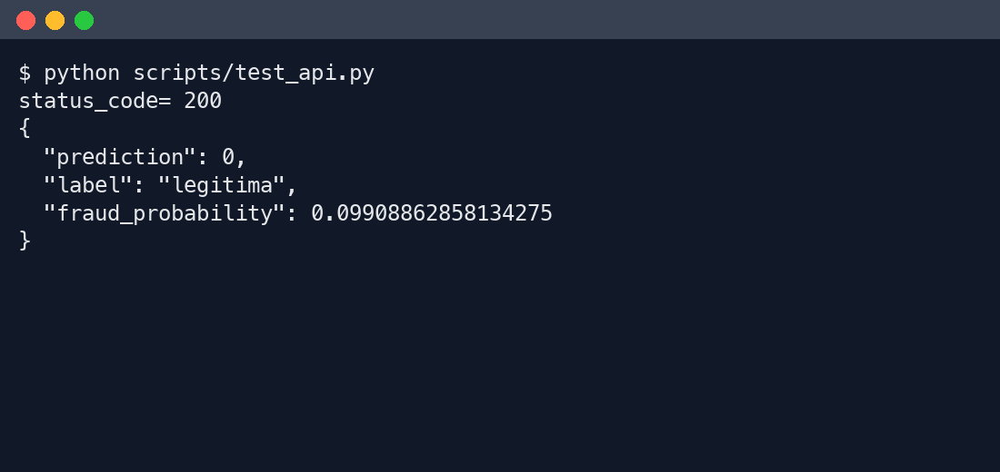

# CP4 — Detecção de Fraude em Cartão de Crédito

Projeto acadêmico de Machine Learning para detectar fraude em transações de cartão de crédito usando MLP, rastreamento de experimentos e API local de predição.

## Autoria

Projeto individual desenvolvido por **Fernando Luiz Silva Antonio**, como atividade acadêmica
de Machine Learning (detecção de fraude em cartão de crédito com MLP).

## Stack principal

- Python 3.10+
- scikit-learn `MLPClassifier`
- imbalanced-learn
- MLflow
- FastAPI

Restrição importante: não usar TensorFlow, Keras ou PyTorch.

## Objetivo

Treinar, comparar e servir localmente um modelo MLP capaz de classificar uma nova transação como legítima ou fraude. Como o dataset é altamente desbalanceado, a seleção do modelo prioriza métricas da classe fraude: recall, precision, F1-score e ROC-AUC. Acurácia é reportada, mas não é usada como métrica principal.

## Estrutura

```text
mlp-deteccao-fraude/
├── data/raw/creditcard.csv      # dataset local, não versionado
├── models/                      # artifacts promovidos após treino
├── notebooks/eda.ipynb          # notebook obrigatório de EDA
├── reports/                     # resultados e roteiro do vídeo
├── scripts/test_api.py          # teste da API
├── src/                         # código de treino, preprocessamento e API
├── requirements.txt
└── README.md
```

## 1. Preparar ambiente

Execute os comandos a partir da pasta que contém o repositório.

Linux/macOS:

```bash
cd mlp-deteccao-fraude
python3 -m venv .venv
source .venv/bin/activate
pip install -r requirements.txt
```

Windows (PowerShell):

```powershell
cd mlp-deteccao-fraude
python -m venv .venv
.\.venv\Scripts\Activate.ps1
python -m pip install -r requirements.txt
```

Se o PowerShell bloquear a ativação, use diretamente o Python do ambiente,
sem alterar a política de execução:

```powershell
.\.venv\Scripts\python.exe -m pip install -r requirements.txt
```

Nesse caso, substitua `python` por `.\.venv\Scripts\python.exe` nos comandos
seguintes. Para abrir o notebook, use `.\.venv\Scripts\jupyter.exe notebook notebooks/eda.ipynb`;
para o MLflow, use `.\.venv\Scripts\mlflow.exe ui`.

## 2. Baixar dataset

Dataset: Kaggle — `mlg-ulb/creditcardfraud`

Baixe o arquivo `creditcard.csv` e salve exatamente em:

```text
data/raw/creditcard.csv
```

O CSV bruto não deve ser commitado no Git.

Verificação (Linux/macOS):

```bash
test -f data/raw/creditcard.csv && echo "dataset ok"
```

Verificação (PowerShell):

```powershell
Test-Path .\data\raw\creditcard.csv
```

### Download pelo navegador ou pela CLI

Para baixar pelo navegador, use sua conta no Kaggle e salve o CSV no caminho
indicado acima; não é necessário configurar um token de API no projeto.

Se optar pela CLI/API, configure a autenticação da sua própria conta. O token
é pessoal, não é compartilhado no repositório e nunca deve ser commitado.
As instruções abaixo usam o arquivo `kaggle.json` e comandos de Linux/macOS.

1. Crie uma conta no Kaggle (se ainda não tiver).
2. Acesse **Account → API → Create New Token**. Isso baixa um arquivo `kaggle.json`.
3. Salve esse arquivo **fora do projeto**, em `~/.kaggle/kaggle.json`, e restrinja a permissão:

   ```bash
   mkdir -p ~/.kaggle
   mv ~/Downloads/kaggle.json ~/.kaggle/kaggle.json
   chmod 600 ~/.kaggle/kaggle.json
   ```

4. Baixe o dataset com a CLI oficial (ou baixe manualmente pela página do dataset no navegador, sem usar token nenhum):

   ```bash
   pip install kaggle
   kaggle datasets download -d mlg-ulb/creditcardfraud -p data/raw --unzip
   ```

Cada pessoa do grupo usa o próprio token — nunca copie ou envie o `kaggle.json` de outra pessoa, e nunca coloque esse arquivo dentro da pasta do projeto (o `.gitignore` já bloqueia `kaggle.json` e `.kaggle/` como proteção extra, mas a regra principal é: o token não deve nem existir dentro do repositório).

## 3. Rodar o notebook obrigatório de EDA

```bash
jupyter notebook notebooks/eda.ipynb
```

O notebook documenta:

- tamanho do dataset;
- colunas disponíveis;
- valores ausentes;
- distribuição da classe `Class`;
- percentual de fraude;
- estatísticas e gráficos de `Time` e `Amount`.



## 4. Treinar modelos e registrar no MLflow

Antes do split, o preparo remove registros exatamente duplicados e rejeita
entradas idênticas com rótulos conflitantes. O CSV original é preservado.
Nesta base foram removidas **1.081 duplicatas**, restando **283.726 transações**,
das quais **473 são fraudes**. O treino usa 198.608 linhas; validação e teste
usam 42.559 linhas cada. Não há entradas idênticas entre os três conjuntos.
As contagens e a verificação estão em `reports/data_preparation.json`.

Os runs corrigidos têm a tag `dataset_policy=exact_duplicates_removed_v1`.
Filtre por essa tag no MLflow para separar os novos resultados dos históricos.
Use `models/best_run.json` para identificar o vencedor atual; os resultados
anteriores à deduplicação não representam esta avaliação.

```bash
python -m src.train
```

O treinamento executa cinco experimentos MLP definidos em `src/experiments.py`, com split estratificado treino/validação/teste. SMOTE ou undersampling é aplicado somente no treino.

Saídas esperadas:

```text
reports/experiment_results.csv
reports/model_selection.md
reports/data_preparation.json
models/best_model.joblib
models/preprocessor.joblib
models/best_run.json
mlruns/
```

## 5. Comparar runs no MLflow

```bash
mlflow ui
```

Abra a URL indicada pelo terminal e compare os runs por parâmetros e métricas.

Para mostrar somente os experimentos sem duplicatas, cole na busca do MLflow:

```text
tags.dataset_policy = 'exact_duplicates_removed_v1'
```

Compare os candidatos pelas métricas `val_*`. As métricas `test_*` são a
avaliação final do vencedor, identificado pela tag `selected_model=true`.

Métricas registradas:

- accuracy;
- precision da classe fraude;
- recall da classe fraude;
- F1-score da classe fraude;
- ROC-AUC.

As duas capturas abaixo são históricas, anteriores à deduplicação. Os resultados
atuais estão na seção seguinte e em `reports/experiment_results.csv`.





## 6. Critério de seleção do melhor modelo

Resultado atual após remover as duplicatas: **MLP-03**, camadas `(64, 32)`,
SMOTE, ReLU, learning rate `0.0001` e limiar **0,83**. Na validação, obteve
precision de 76%, recall de 80,28% e F1 de 78,08%, o maior F1 entre os cinco
candidatos, todos com recall acima de 80% nessa etapa.

No teste separado: **precision 66,67%, recall 78,87%, F1 72,26% e ROC-AUC
0,9535**. Foram detectadas 56 das 71 fraudes, com 28 falsos positivos. O recall
ficou abaixo da meta de referência de 80%; não reajustamos o modelo ou o limiar
usando o teste. Esses resultados substituem os anteriores à deduplicação.

O melhor modelo é escolhido pelo maior F1-score da classe fraude entre os modelos com recall aceitável. Em caso de empate, ROC-AUC desempata.

O run escolhido e a justificativa estão em [reports/model_selection.md](reports/model_selection.md).
As métricas finais também são registradas no MLflow e em `models/best_run.json`.

Metas de referência:

- recall fraude >= 0.80;
- precision fraude >= 0.60;
- F1-score fraude >= 0.70;
- ROC-AUC >= 0.90.

## 7. Iniciar API local

A API recupera `runs:/<best_run_id>/sklearn_model` do MLflow local. O
preprocessador e o limiar são recuperados do mesmo run. `models/best_run.json`
identifica o vencedor; as cópias `.joblib` em `models/` não são usadas pela API.
Mantenha a pasta `mlruns/` da execução disponível. O tracking usa um caminho
absoluto baseado na raiz do projeto, inclusive no Windows.

O treinamento registra as métricas `test_*` e a tag `selected_model=true` no
run vencedor. `/health` só informa `ready` depois de carregar os artefatos e
retorna o `run_id` servido.

Depois do treino gerar os artifacts em `models/`:

```bash
uvicorn src.api:app --reload
```

No Windows, com o Python que contém as dependências, use:

```powershell
python -m uvicorn src.api:app --host 127.0.0.1 --port 8000
```

Para validar a integração com os artefatos locais e as entradas inválidas:

```bash
python -m unittest discover -s tests -v
```

Esses testes requerem um treino concluído e `httpx` disponível no ambiente.

Health check:

```bash
curl http://127.0.0.1:8000/health
```

A documentação interativa fica disponível em `http://127.0.0.1:8000/docs`:



## 8. Testar predição

Em outro terminal, com o ambiente ativado:

```bash
python scripts/test_api.py
```

Exemplo ilustrativo do formato da resposta:

```json
{
  "prediction": 0,
  "label": "legitima",
  "fraud_probability": 0.03
}
```

Os valores podem mudar conforme o modelo treinado.

Captura histórica da resposta, anterior ao treinamento sem duplicatas:



## Contrato POST /predict

Entrada JSON com todos os campos numéricos:

```json
{
  "Time": 10.2,
  "V1": -1.35,
  "V2": -0.07,
  "V3": 2.53,
  "V4": 1.38,
  "V5": -0.34,
  "V6": 0.46,
  "V7": 0.24,
  "V8": 0.10,
  "V9": 0.36,
  "V10": 0.09,
  "V11": -0.55,
  "V12": -0.62,
  "V13": -0.99,
  "V14": -0.31,
  "V15": 1.47,
  "V16": -0.47,
  "V17": 0.20,
  "V18": 0.03,
  "V19": 0.40,
  "V20": 0.25,
  "V21": -0.02,
  "V22": 0.28,
  "V23": -0.11,
  "V24": 0.07,
  "V25": 0.13,
  "V26": -0.19,
  "V27": 0.13,
  "V28": -0.02,
  "Amount": 149.62
}
```

Saída ilustrativa (a probabilidade depende do modelo e da transação):

```json
{
  "prediction": 0,
  "label": "legitima",
  "fraud_probability": 0.03
}
```

## Troubleshooting

### Dataset não encontrado

Erro esperado se `data/raw/creditcard.csv` estiver ausente. Baixe do Kaggle e coloque no caminho correto.

### API retorna erro 503

Significa que a API não conseguiu carregar o modelo selecionado. Isso pode
ocorrer se `models/best_run.json` estiver ausente ou inválido, se o run indicado
não estiver ativo e concluído, ou se o modelo, o preprocessador ou o limiar
desse run estiverem indisponíveis ou inválidos.

Confira o erro no terminal da API e a disponibilidade da pasta `mlruns/`.
Se ainda não houver um treinamento completo, execute:

```bash
python -m src.train
```

Após corrigir os artefatos ou concluir um novo treinamento, reinicie a API e
confirme em `/health` que `ready` é `true` e que `run_id` corresponde ao vencedor.

### MLflow UI não mostra runs

Confirme que o comando foi executado a partir da raiz do projeto e que a pasta `mlruns/` foi criada localmente.

## Prints do README

As capturas de MLflow e API usadas neste documento são ilustrações históricas da interface,
anteriores ao novo treinamento sem duplicatas. Para apresentar resultados,
use os runs atuais filtrados por `dataset_policy`, o relatório de seleção e
a resposta ao vivo da API. O gráfico de classes acompanha o notebook atual.

Os 5 prints usados neste README estão salvos em `docs/images/`:

| Arquivo | Conteúdo |
| --- | --- |
| `docs/images/notebook-class-distribution.png` | Distribuição da classe `Class` no dataset. |
| `docs/images/mlflow-runs-list.png` | Tela do MLflow listando os 5 runs `MLP-01` a `MLP-05`. |
| `docs/images/mlflow-runs-compare.png` | Comparação visual das métricas dos 5 experimentos. |
| `docs/images/api-swagger-docs.png` | Swagger UI do FastAPI com endpoint `POST /predict`. |
| `docs/images/api-test-response.png` | Resposta do comando `python scripts/test_api.py`. |

## Vídeo

[Assistir ao vídeo explicativo](https://drive.google.com/file/d/1mbYVa6JqWQfUCe69Pbrn0bDp3qqj31zE/view?usp=sharing)

O [roteiro usado na gravação](reports/video_script.md) também está disponível no repositório.

